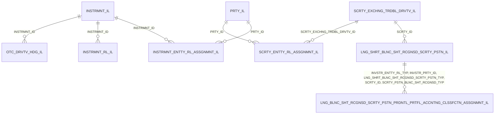

# Reporting data mart: data model

Input tables of the reporting data mart. Every table carries the reporting context: reference date, reporting
agent, consolidation level and accounting standard. Table and column names follow the ECB BIRD input layer.

| Table | Name |
|---|---|
| [INSTRMNT_IL](INSTRMNT_IL.md) | Instrument |
| [INSTRMNT_RL_IL](INSTRMNT_RL_IL.md) | Instrument role |
| [INSTRMNT_ENTTY_RL_ASSGNMNT_IL](INSTRMNT_ENTTY_RL_ASSGNMNT_IL.md) | Instrument Entity role assignment |
| [PRTY_IL](PRTY_IL.md) | Party |
| [INTRNL_GRP_RL_IL](INTRNL_GRP_RL_IL.md) | Internal group role |
| [OTC_DRVTV_HDG_IL](OTC_DRVTV_HDG_IL.md) | Over the counter (OTC) Derivative as a hedge |
| [SCRTY_EXCHNG_TRDBL_DRVTV_IL](SCRTY_EXCHNG_TRDBL_DRVTV_IL.md) | Security and exchange tradable derivative |
| [SCRTY_ENTTY_RL_ASSGNMNT_IL](SCRTY_ENTTY_RL_ASSGNMNT_IL.md) | Security Entity role assignment |
| [LNG_SHRT_BLNC_SHT_RCGNSD_SCRTY_PSTN_IL](LNG_SHRT_BLNC_SHT_RCGNSD_SCRTY_PSTN_IL.md) | Long/Short balance sheet recognised security position |
| [LNG_BLNC_SHT_RCGNSD_SCRTY_PSTN_PRDNTL_PRTFL_ACCNTNG_CLSSFCTN_ASSGNMNT_IL](LNG_BLNC_SHT_RCGNSD_SCRTY_PSTN_PRDNTL_PRTFL_ACCNTNG_CLSSFCTN_ASSGNMNT_IL.md) | Long balance sheet recognised security position prudential portfolio Accounting classification assignment |

## Relationships

