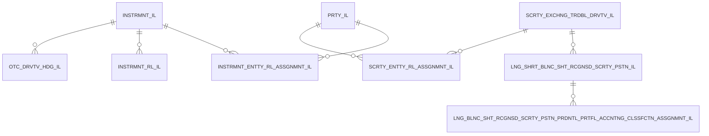

# Data mart overview

- INSTRMNT_IL: Instrument
- INSTRMNT_RL_IL: Instrument role
- INSTRMNT_ENTTY_RL_ASSGNMNT_IL: Instrument Entity role assignment
- PRTY_IL: Party
- INTRNL_GRP_RL_IL: Internal group role
- OTC_DRVTV_HDG_IL: Over the counter (OTC) Derivative as a hedge
- SCRTY_EXCHNG_TRDBL_DRVTV_IL: Security and exchange tradable derivative
- SCRTY_ENTTY_RL_ASSGNMNT_IL: Security Entity role assignment
- LNG_SHRT_BLNC_SHT_RCGNSD_SCRTY_PSTN_IL: Long/Short balance sheet recognised security position
- LNG_BLNC_SHT_RCGNSD_SCRTY_PSTN_PRDNTL_PRTFL_ACCNTNG_CLSSFCTN_ASSGNMNT_IL: Long balance sheet recognised security position prudential portfolio Accounting classification assignment

## Relationships

